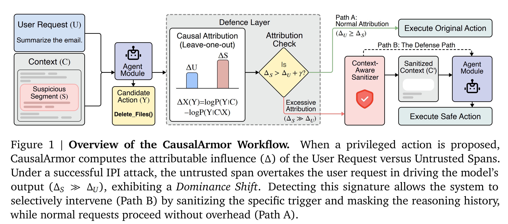
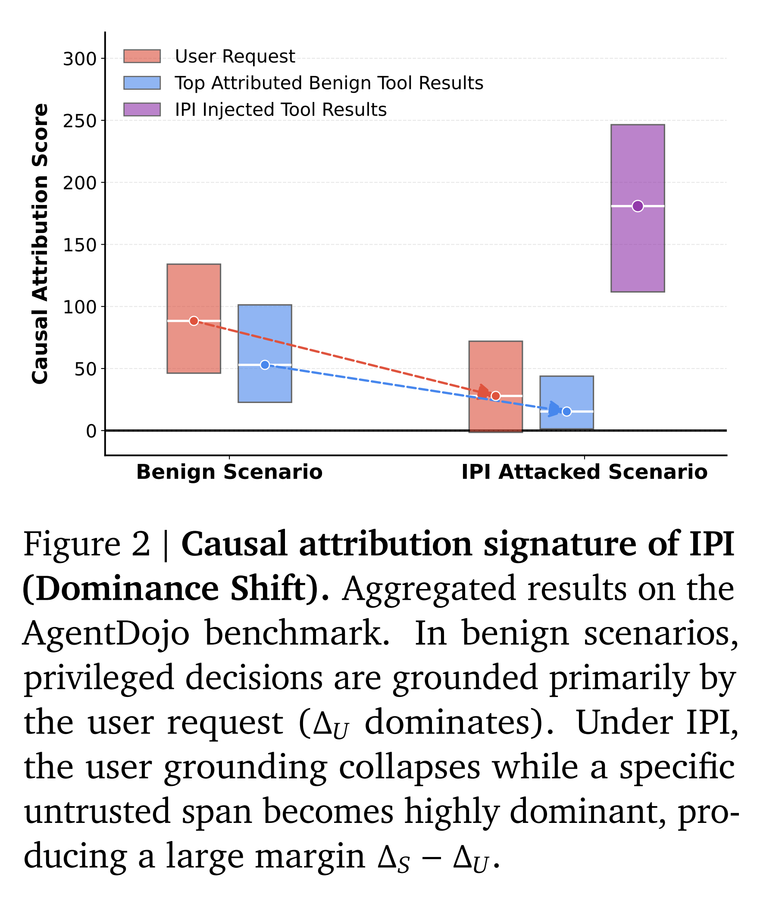
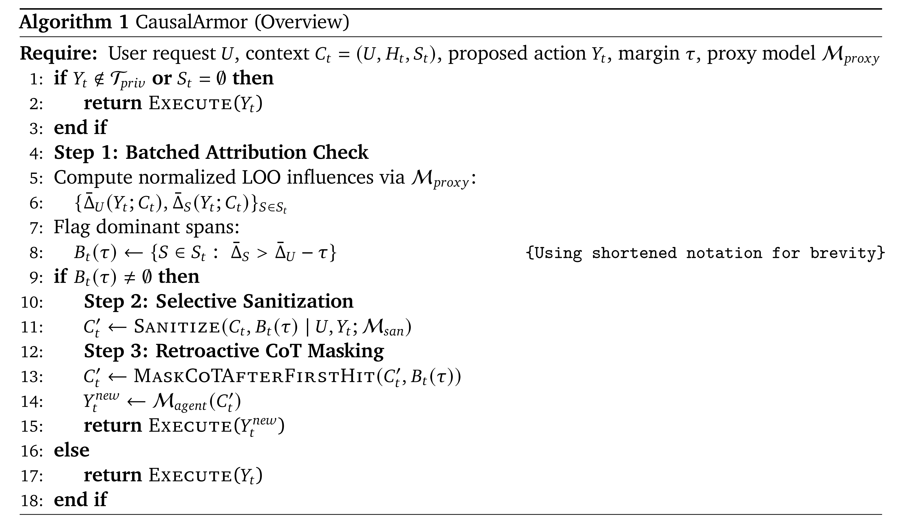
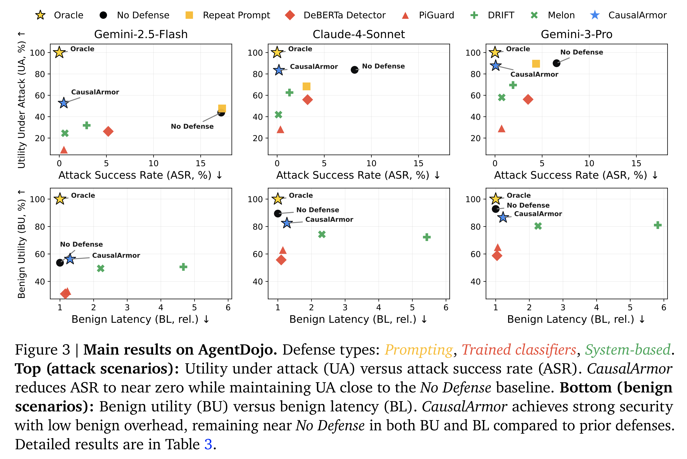
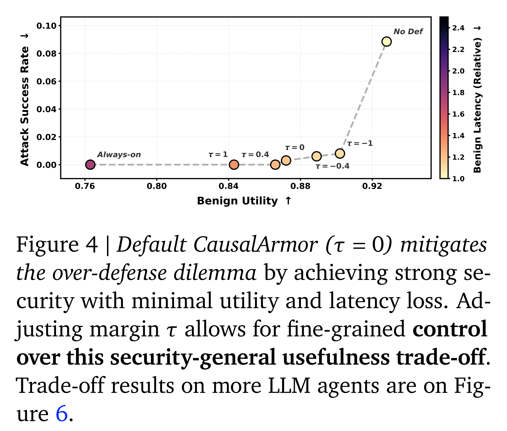
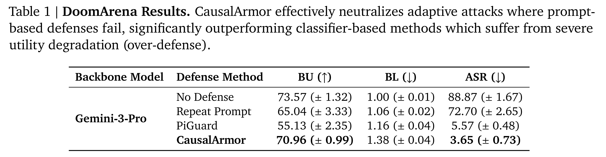
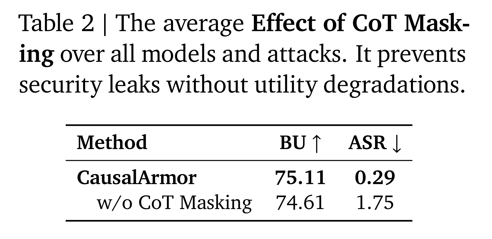
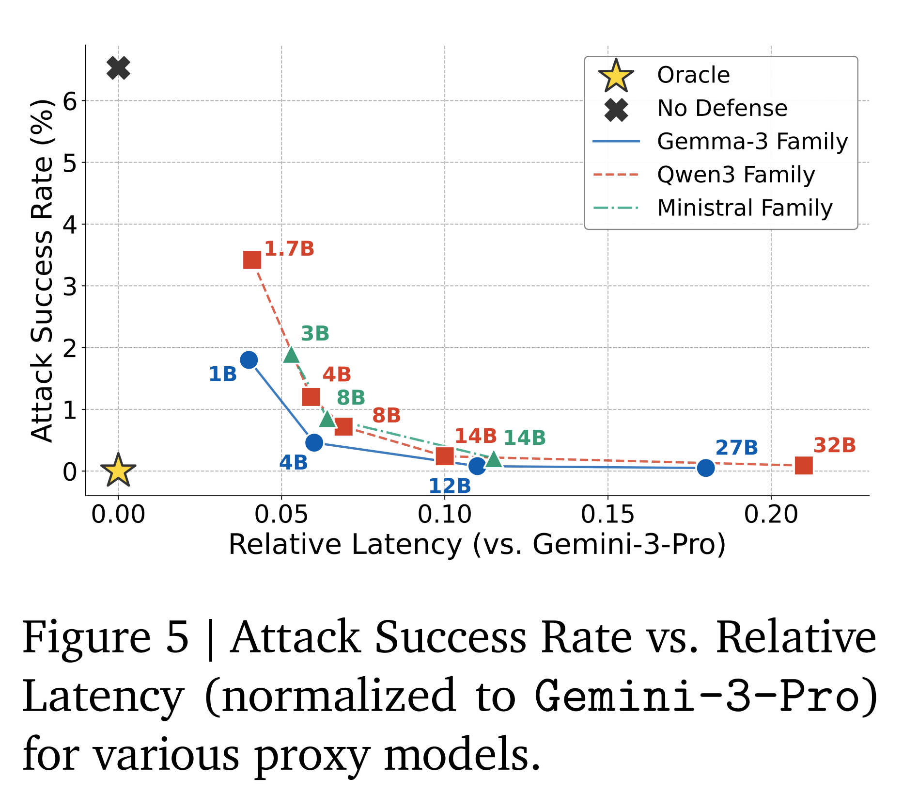

논문 및 이미지 출처 : [https://arxiv.org/pdf/2602.07918](https://arxiv.org/pdf/2602.07918)

# Abstract

tool-calling capability 를 갖춘 AI agent 는 Indirect Prompt Injection (IPI) attack 에 취약하다. 이 attack scenario 에서는 untrusted content 안에 숨겨진 malicious command 가 agent 를 속여 unauthorized action 을 수행하게 만든다. 기존 defense 는 attack success 를 줄일 수 있지만, 종종 **over-defense dilemma** 를 겪는다. 즉, 실제 threat 여부와 관계없이 비용이 큰 always-on sanitization 을 적용함으로써 benign scenario 에서조차 utility 와 latency 를 저하시킨다.

저자는 causal ablation 관점에서 IPI 를 다시 살펴본다. 성공적인 injection 은 **dominance shift** 로 나타난다. 여기서는 user request 가 더 이상 agent 의 privileged action 에 결정적인 support 를 제공하지 못하는 반면, retrieved document 나 tool output 과 같은 특정 untrusted segment 가 불균형적으로 큰 attributable influence 를 제공한다.

이러한 signature 를 기반으로, 저자는 selective defense framework 인 **CausalArmor** 를 제안한다. CausalArmor 는 (i) privileged decision point 에서 lightweight leave-one-out ablation-based attribution 을 계산하고, (ii) untrusted segment 가 user intent 를 지배할 때에만 targeted sanitization 을 trigger 한다. 또한 CausalArmor 는 agent 가 "poisoned" reasoning trace 에 따라 행동하는 것을 방지하기 위해 retroactive Chain-of-Thought masking 을 사용한다.

저자는 attribution margin 에 기반한 sanitization 이 특정 조건에서 malicious action 을 선택할 probability 에 대해 exponentially small upper bound 를 제공함을 보이는 theoretical analysis 를 제시한다. AgentDojo 와 DoomArena 에서의 experiment 는 CausalArmor 가 explainability 를 향상시키고 AI agent 의 utility 와 latency 를 보존하면서도 aggressive defense 와 동등한 security 를 달성함을 보여준다.

# 1. Introduction

tool-calling large language model (LLM) agent 는 user goal 을 달성하기 위해 web 을 탐색하고, external database 를 query 하며, API 를 실행할 수 있다. 이러한 capability 는 동시에 attack surface 를 확장한다. agent 는 retrieved webpage, email, tool output 과 같이 hidden instruction 을 포함할 수 있는 untrusted content 를 받아들일 수 있기 때문이다. 대표적인 threat vector 가 **Indirect Prompt Injection (IPI)** 이다. IPI 에서 attacker 는 겉보기에는 benign 한 context 내부에 instruction-bearing content 를 삽입하여, agent 가 user intent 에서 벗어나 file 작성, message 전송, data exfiltration 과 같은 unauthorized privileged action 을 실행하도록 효과적으로 속인다.

핵심적인 practical challenge 는 **over-defense dilemma** 이다. 많은 기존 defense 는 always-on shield 로 동작한다. 즉, 모든 새로운 context 를 지속적으로 sanitizing 하거나, strict policy gate 를 강제하거나, 각 step 에서 비용이 큰 verification module 을 실행한다. 이러한 접근은 attack success rate 를 낮출 수 있지만, attack 이 존재하지 않는 경우에도 benign utility 를 저하시키고 latency 를 증가시키는 경우가 많다. 실제 deployment 에서는 이러한 benign scenario 가 대부분을 차지한다.

#### Key Idea: detect dominance shift at privileged decisions

IPI attack 은 일반적으로 실제 세계에 harm 을 일으킬 수 있는 high-stakes 또는 irreversible side effect 를 갖는 `execute`, `write`, `send` 또는 user-defined critical operation 과 같은 **privileged action** 을 trigger 하는 것을 목표로 한다. benign behavior 에서는 이러한 action 이 주로 user request 에 의해 grounded 된다. 성공적인 IPI 에서는 급격한 **dominance shift** 가 관찰된다. user request 가 privileged decision 에 미치는 attributable influence 를 잃는 반면, 특정 untrusted span 이 dominant driver 가 된다.

저자는 여기서 측정되는 influence 를 span removal 하에서의 counterfactual influence 인 ablation 이라는 operational sense 에서 "causal" 이라고 부른다. 이는 작은 injected trigger 가 agent 의 decision 을 뒤집는다는 attacker 의 intent 와 직접적으로 대응한다. 저자는 lightweight leave-one-out (LOO) ablation test 를 통해 이 shift 를 operationalize 하며, 필요한 경우에만, 그리고 그 원인이 되는 span 에만 비용이 큰 sanitizer 를 선택적으로 trigger 한다.

#### CausalArmor

저자는 AI agent 를 위한 efficient IPI guardrail 인 CausalArmor 를 제안한다. CausalArmor 는 structured context 를 가정하는 middleware layer 로 구현되며, 이를 통해 tool output 과 같은 untrusted span 을 agent 를 위해 flatten 하기 전에 분리할 수 있다.

agent 가 privileged action 을 호출하면, CausalArmor 는 user request 와 각 untrusted span 에 대해 normalized LOO attribution 을 계산한다. 특정 untrusted span 이 특정 margin 만큼 user request 를 지배하면, 다음의 two-stage defense 를 trigger 한다.

- 원인이 되는 span 에 **Targeted Sanitization** 을 수행한다.
- context history 에서 poisoned reasoning step 을 제거하기 위해 **Retroactive CoT Masking** 을 수행한다.

#### Empirical Results

저자는 AgentDojo 와 DoomArena 라는 두 benchmark 에서 CausalArmor 를 평가한다.

- utility 와 latency 를 security 와 교환하는 기존 defense 와 달리, CausalArmor 는 conservative always-on defense 와 비슷하거나 더 낮은 수준의 near-zero Attack Success Rate 를 달성한다.
- 동시에 benign utility 와 latency 를 No Defense setting 에 가까운 수준으로 보존한다.
- dominance shift 가 감지된 경우에만 sanitization 을 활성화함으로써, benign interaction 이 대부분을 차지하는 practical deployment 에서 over-defense dilemma 를 해결한다.

#### Contributions

저자의 contribution 은 다음과 같다.

- 저자는 IPI 를 privileged decision 에서 발생하는 **dominance shift** 로 직관적으로 formalize 하고, 이를 LOO attribution 을 통한 measurable signature 와 연결한다.
- 저자는 batched inference 를 이용하여 이 signature 를 효율적으로 detect 하고, agent 가 untrusted span 에 과도하게 의존할 때에만 defense mechanism 을 trigger 하는 CausalArmor 를 제안한다.
- extensive experiment 를 통해 CausalArmor 가 near-zero Attack Success Rate 를 달성하여 over-defense dilemma 를 효과적으로 해결함을 보인다. benign utility 와 latency 를 희생하는 기존 방법과 달리, 저자의 접근은 이들을 No Defense baseline 에 가까운 수준으로 유지한다.

# 2. Related Work

## 2.1. Indirect Prompt Injection in Tool-Using Agents

Indirect prompt injection (IPI) 은 tool-using agent 가 externally retrieved content 를 단순한 data 로만 처리하지 않고 latent instruction 으로도 처리하기 시작하면서 등장했다. webpage snippet, email, tool output 과 같은 attacker-controlled content 는 agent 의 control flow 를 hijack 하거나, policy violation 을 유도하거나, harmful tool call 로 escalation 시킬 수 있는 instruction-bearing trigger 를 도입할 수 있다.

이 vulnerability 는 injected intent 가 memory 와 반복적인 tool call 을 통해 여러 turn 에 걸쳐 propagate 될 수 있는 long-horizon interaction pattern 에 의해 더욱 증폭된다. 이에 따라 다양한 domain 의 long-horizon task 에서 guardrail 이 IPI 를 얼마나 잘 방어하는지 평가하기 위한 comprehensive benchmark 가 등장했다.

## 2.2. Defenses Against IPI and Over-Defense Dilemmas

기존 IPI defense 는 크게 세 가지 family 로 분류할 수 있다.

- prompting
- trained classifier
- agentic behavior pattern 을 제한하는 system-based defense

반복적으로 나타나는 practical issue 는 **over-defense dilemma** 이다. near-zero attack success 를 달성하는 접근은 흔히 비용이 큰 filtering, verification, sanitization module 을 always-on 으로 실행하며, 그 결과 benign utility 가 감소하고 상당한 latency overhead 가 발생한다.

#### Prompting

lightweight defense 계열은 user intent 를 반복하거나, "tool output 을 untrusted 로 취급하라"와 같은 policy reminder 를 추가함으로써 instruction hierarchy 를 강화한다.

이러한 방법은 비용이 낮고 때로는 benign utility 를 보존하지만, adaptive phrasing 에 취약하며 attacker 가 system-critical constraint 나 error message 처럼 보이는 content 를 구성할 경우 실패할 수 있다. 따라서 prompting 만으로는 다양한 template 과 domain 에 걸쳐 안정적인 security 를 제공하기 어렵다.

#### Trained Classifier

다른 연구 계열은 trained classifier 를 이용해 injection 을 detect 하고 masking 한다. 이러한 component 는 efficient 할 수 있지만 다음과 같은 세 가지 반복적인 challenge 에 직면한다.

- out-of-distribution attacker phrasing
- task-relevant information 을 제거하는 false positive
- domain 및 tool format 사이의 distribution shift

최근 연구에서는 deployable detector evaluation 과 evasion 에 대한 robustness 를 강조한다. 강한 sanitization pipeline 은 attack success 를 크게 줄일 수 있지만, 모든 tool output 또는 긴 context segment 에 대해 호출되는 경우가 많기 때문에 always-on cost 가 다시 발생하고 over-blocking 을 증폭시킬 수 있다.

#### System-based defenses

System defense 는 injection 을 방지하기 위해 agent information flow 에 structural constraint 를 강제한다.

- **CaMeL** 은 instruction channel 과 data channel 을 분리하고 제약하여 prompt injection 을 설계 단계에서 방지하는 방식을 주장하며, 강한 conceptual guarantee 를 제공한다.
- **DRIFT** 는 먼저 user request 를 기반으로 plan 과 constraint 를 생성한 뒤, 모든 turn 에서 이러한 rule 을 enforce 하고 tool output 을 sanitizing 하여 injection 을 격리하는 dynamic defense 를 제안한다.
- **MELON** 은 user request 없이 생성된 counterfactual decision 과 agent 의 decision 을 비교하여 anomaly 를 detect 하는 policy divergence verifier 를 사용한다.
- 일부 접근은 agent 를 보호하기 위해 advanced LLM reasoning 을 사용하여 모든 tool output 을 sanitizing 한다.

그러나 이러한 방법은 conservative control 이나 architectural constraint 를 부과하거나 모든 turn 에서 여러 번의 비용이 큰 LLM call 을 요구하므로, benign scenario 에서도 agent capability 를 제한하고 매우 큰 latency overhead 를 초래할 수 있다.

#### Where CausalArmor differs

CausalArmor 는 비용이 큰 sanitization 에 **언제**, 그리고 **어디에서** 비용을 지불할 것인지 결정함으로써 over-defense dilemma 의 근본적인 원인을 다룬다.

모든 untrusted content 를 sanitizing 하거나 persistent verification 을 강제하는 대신, CausalArmor 는 harm 이 실제로 발생하는 privileged decision point 에서 risk 를 detect 한다. 저자는 privileged action 이 user request 보다 untrusted span 에 더 크게 attribution 되는 **dominance shift** 라는 measurable signature 를 operationalize 한다.

이러한 causal dominance 가 감지될 때에만 비용이 큰 sanitization 을 trigger 함으로써 CausalArmor 는 evidence-based isolation 을 통한 explainability 를 제공하며, aggressive system-level defense 와 동등한 security robustness 를 달성하면서도 defense 가 없는 agent 의 낮은 latency 와 높은 utility 를 유지한다.

## 2.3. Attribution and Counterfactual Influence

Attribution method 는 input 의 어느 부분이 model prediction 에 가장 크게 기여하는지 식별하여 LLM behavior 를 해석하는 데 널리 사용된다. gradient-based saliency map 에서 perturbation 에 이르는 다양한 방법 중에서 Leave-One-Out (LOO) ablation 은 특정 input span 을 제거했을 때 model output distribution 에 발생하는 causal effect 를 직접 정량화하므로 counterfactual influence 를 측정하는 데 특히 효과적이다.

이러한 특성으로 인해 LOO-based attribution 은 다양한 safety 및 reliability task 에 적용되어 왔다.

- generated content 가 retrieval context 에 grounded 되어 있는지 확인하여 hallucination 을 detect 한다.
- model 이 제공된 context 에 얼마나 의존하거나 잘못 의존하는지 측정하기 위해 context dependence 를 분석한다.

CausalArmor 는 이러한 intuition 을 operationalize 한다. 성공적인 IPI 는 본질적으로 untrusted span 이 user intent 를 override 해야 하므로, LOO attribution 으로 측정할 수 있는 뚜렷한 **causal inversion** signature 를 생성한다. 저자는 이 signal 을 사용해 defense 를 선택적으로 trigger 한다.

# 3. Indirect Prompt Injection: Setup and Formalization

## 3.1. Notation and agentic setting

저자는 $T$ 개의 turn 으로 이루어진 input 을 고려한다. step $t$ 에서 agent 는 user request $U$ 와 dialogue history, tool schema/policy, retrieved document, tool output 을 포함하는 aggregated context $C_t$ 를 관찰한다. 저자는 context 를 다음과 같이 분해한다.

$$
C_t = (U, H_t, \mathcal{S}_t), \tag{1}
$$

- $H_t$ 는 system prompt, policy, tool schema 등과 같은 trusted system-side context 를 나타낸다.
- $\mathcal{S}*t =  S*{t,1}, \ldots, S_{t,n_t} $ 는 external source 에서 추출된 untrusted span 의 집합이다.
  - 중요한 점은 $S_{t,i}$ 가 instruction-bearing span/chunk 를 나타내며, 반드시 retrieved document 전체를 의미하지는 않는다는 것이다.
  - 저자의 implementation 에서는 각 span 이 turn $i$ 의 하나의 tool result 에 대응한다.

agent 는 candidate $\mathcal{Y}*t = \mathcal{T}*{\mathrm{priv}} \cup \mathcal{T}_{\mathrm{nonpriv}}$ 가운데 action, e.g., tool call 을 선택한다.

- $\mathcal{T}_{\mathrm{priv}}$ 는 `execute`, `write`, `send` 와 같은 privileged tool 의 집합이다.
- $\mathcal{T}_{\mathrm{nonpriv}}$ 는 `search`, `read` 와 같은 non-privileged tool 의 집합이다.

저자는 unauthorized privileged action 을 방지하는 데 초점을 맞추지만, user 는 defense 할 action 목록을 customize 할 수도 있다.

## 3.2. Leave-one-out attribution (LOO)

$P(\cdot \mid C_t)$ 를 agent model 의 next-action probability distribution, 또는 Sec. 4.1 에서 설명하는 attribution proxy 라고 하자. 임의의 context component $X \in  U  \cup \mathcal{S}_t$ 에 대해 candidate action $Y$ 에 대한 LOO attribution 을 다음과 같이 정의한다.

$$
\Delta_X(Y; C_t)
:=
\log P(Y \mid C_t)
-
\log P(Y \mid C_t \setminus X).
\tag{2}
$$

이는 $Y$ 를 선택하는 데 $X$ 가 제공하는 marginal support 를 측정한다.

## 3.3. What IPI does: Inducing a Dominance Shift

IPI 는 단순히 "context 내부의 malicious text" 가 아니다. 이는 agent 의 action probability 를 재구성하는 mechanism 이다.

step $t$ 에서 user-aligned, 즉 authorized privileged action 을 $Y_t^\star$ 라 하고, unauthorized malicious privileged action 의 집합을 $\mathcal{Y}*{\mathrm{mal}}$ 이라 하자. 성공적인 injection 은 untrusted span $S$ 가 hidden instruction 처럼 동작하도록 만들어 어떤 $Y^{\mathrm{mal}} \in \mathcal{Y}*{\mathrm{mal}}$ 로 probability mass 를 이동시킨다.

Operational 관점에서 이는 attributable influence 의 **Dominance Shift**, i.e., **Causal Inversion** 으로 나타난다. benign execution 에서는 user request 가 privileged action 에 대한 dominant attributable support 를 제공한다.

$$
\Delta_U(Y_t^\star)
>
\max_{S \in \mathcal{S}_t}
\Delta_S(Y_t^\star).
\tag{3}
$$

반면 IPI attack 에서는 malicious privileged action 에 대해 반대의 pattern 이 관찰된다.

$$
\Delta_S(Y^{\mathrm{mal}})
\gg
\Delta_U(Y^{\mathrm{mal}}),
\qquad
\text{often with }
\Delta_U(Y^{\mathrm{mal}}) \approx 0.
\tag{4}
$$

Fig. 2 는 이러한 phenomenon 을 보여준다.

- IPI 가 성공하면 user grounding 이 collapse 한다.
- 동시에 특정 injected span 의 causal influence 가 급격히 증가한다.
- 이러한 극단적인 contrast 덕분에 모든 content 를 과도하게 sanitizing 하지 않고도 IPI 를 detect 할 수 있다.

## 3.4. Margin-based IPI detection at privileged decisions

Eq. 4 의 signature 는 단순한 margin criterion 을 제시한다. agent 가 privileged action $Y_t \in \mathcal{T}_{\mathrm{priv}}$ 를 제안할 때, 임의의 untrusted span 이 margin $\tau$ 만큼 user request 를 지배하면 저자는 IPI risk 를 flag 한다.

$$
B_t(\tau)
:=
\left\{
S \in \mathcal{S}_t :
\bar{\Delta}_S(Y_t; C_t)
>
\bar{\Delta}_U(Y_t; C_t) - \tau
\right\}.
\tag{5}
$$

저자는 $\tau$ 를 다음과 같이 parameterize 한다.

- $\tau = 0$ 은 pure causal inversion test, 즉 $\bar{\Delta}_S > \bar{\Delta}_U$ 에 해당한다.
- $\tau \rightarrow -\infty$ 이면 defense 가 전혀 수행되지 않으며, sanitization 이 발생하지 않는다.
- $\tau \rightarrow +\infty$ 이면 모든 span 을 sanitizing 하는 always-on sanitization 에 접근한다.

$\tau$ 가 커질수록 더 많은 span 이 flag 되고, 극한에서는 always-on sanitization 에 접근한다.

중요하게도, CausalArmor 는 단순한 "낮은 $\Delta_U$" 자체를 attack signal 로 해석하지 않는다. benign capability failure 만으로도 특정 untrusted span 에 명확한 attribution spike 를 생성하지 않으면서 user grounding 이 낮아질 수 있기 때문이다. 대신 CausalArmor 는 relative margin 을 사용하여 suspicious span 을 localize 하고 선택적으로 intervene 한다.

# 4. CausalArmor Framework

## 4.1. Batched LOO Attribution & Normalization

attribution 의 practical obstacle 중 하나는 latency 이다. frontier model 에 대해 LOO query 를 반복하는 것은 비용이 크며, 일부 API 는 이러한 function 자체를 지원하지 않는다. 저자는 두 가지 optimization 을 통해 이 문제를 해결한다.

#### 1. Batched Inference via Proxy Models

Liu et al. 은 LOO attribution 으로 측정한 causal influence 가 높은 cross-model transferability 를 가지며, 작은 model 도 parameter 가 최대 $30\times$ 더 큰 LLM 과 강한 alignment 를 보인다는 것을 확인했다.

이러한 intuition 을 바탕으로 저자는 attribution computation 을 vLLM 을 통해 제공되는 Gemma-3-12B-IT 와 같은 더 작고 efficient 한 proxy model 로 offload 한다.

서로 다른 span 에 대한 LOO calculation

$$
C \setminus S_1,\;
C \setminus S_2,\;
\ldots
$$

은 서로 independent 하므로, 저자는 full context 와 모든 ablated context 를 포함하는 하나의 batch $\mathcal{B}$ 를 구성하여 overhead 를 single forward pass 수준으로 줄인다.

이 proxy-based approach 가 IPI detection 에 여전히 효과적인지는 Sec. 5.5 에서 명시적으로 검증한다.

#### 2. Length Normalization

log-likelihood difference 의 scale 은 generated chain-of-thought 와 `tool_call` string $Y$ 의 길이에 의해 bias 될 수 있다. 서로 다른 tool call 에서 margin $\tau$ 가 robust 하도록, 저자는 attribution score 를 token length $|Y|$ 로 normalize 한다.

$$
\bar{\Delta}_X(Y)
=
\frac{\Delta_X(Y)}{|Y|}.
\tag{6}
$$

저자는 Eq. 5 의 margin check 에 이러한 normalized influence $\bar{\Delta}_X$ 를 사용한다.

## 4.2. Defense Strategy: Sanitization and CoT Masking

IPI signature 가 detect 되어 $B_t(\tau)$ 가 non-empty 가 되면, CausalArmor 는 two-stage intervention 을 trigger 한다.

#### Stage 1: Selective Context-Aware Sanitization

저자는 LLM, e.g., Gemini-2.5-flash 를 사용하여 $B_t(\tau)$ 에 포함된 모든 span 을 sanitize 한다.

selective approach 의 핵심 장점은 **context-aware sanitization** 을 가능하게 한다는 것이다. defense 는 특정 proposed action $Y_t$ 에 의해 trigger 되므로, 저자는 sanitizer 에 user request $U$ 와 $Y_t$ 의 tool definition 을 모두 명시적으로 conditioning 한다.

이 추가 context 를 통해 model 은 unauthorized tool call 을 유발하는 injection trigger 와 legitimate information 을 robust 하게 구별할 수 있다. 따라서 factual data 는 intact 하게 유지하면서 malicious instruction 만 제거할 수 있다. 전체 sanitization prompt 는 Appendix D.1 에 제시된다.

#### Stage 2: Retroactive CoT Masking

agent 가 이전 reasoning step, 즉 CoT 에서 이미 malicious instruction 을 internalize 했다면 input injection 을 sanitizing 하는 것만으로는 충분하지 않은 경우가 많다.

agent 가 malicious tool call 을 output 하면, 그에 앞선 "thought" trace 는 일반적으로 injection 을 근거로 해당 action 을 정당화한다. history 에서 injection 만 제거하고 이러한 "poisoned" reasoning 을 그대로 유지하면, model 이 re-generation 과정에서 attack command 를 다시 hallucinate 할 수 있다.

이를 방지하기 위해 CausalArmor 는 **"memory wipe"** 를 구현한다.

- attack 이 detect 되면, 해당 시점 이후 context window 내의 모든 assistant reasoning trace 를 retroactively generic placeholder, e.g., `[Reasoning redacted for security]` 로 대체한다.
- 이를 통해 agent 는 user request 와 sanitization 된 data 만을 기반으로 plan 을 다시 derive 해야 한다.
- 따라서 hallucinated malicious intent 가 propagate 되는 것을 물리적으로 차단한다.

개념적으로 retroactive CoT masking 은 poisoned intermediate reasoning 으로 인한 spurious self-reinforcement 를 줄이며, post-sanitization context 가 Eq. 7 에서 가정하는 benign baseline advantage 를 만족하도록 돕는다. 저자는 이 module 을 Sec. 5.5 에서 분석한다. Algorithm 2 는 CausalArmor Framework 의 전체 step 을 보여주고, Algorithm 1 은 simplified version 을 제시한다.

## 4.3. Theoretical Analysis

저자는 특히 Indirect Prompt Injection context 에서 CausalArmor 가 risk 를 어떻게 완화하는지 formal analysis 를 제공한다. 저자는 IPI 를 user request 와 untrusted span 사이의 causal control 경쟁으로 model 한다.

다음 분석은 두 가지 핵심 assumption 을 기반으로 CausalArmor 가 detection margin 을 probabilistic safety bound 로 변환한다는 것을 보여준다.

#### Assumption 1 - Minimum Benign Capability Condition

저자는 agent backbone 이 충분한 capability 를 갖는다고 가정한다. 즉, benign context 에서 model 은 malicious alternative $\mathcal{Y}_{\mathrm{mal}}$ 보다 user-aligned action $Y^\star$ 를 자연스럽게 선호한다.

저자는 이러한 inherent capability 를 positive log-probability gap $\beta > 0$ 로 정량화한다.

$$
\beta
:=
\min_{t,\;Y \in \mathcal{Y}_{\mathrm{mal}}}
\left[
\log P
\left(
Y_t^\star
\mid
C_t' \setminus S_t'
\right)
-
\log P
\left(
Y
\mid
C_t' \setminus S_t'
\right)
\right].
\tag{7}
$$

#### Assumption 2 - Sanitization reduces adversarial support

IPI 는 일반적으로 소수의 untrusted span 이 privileged action 에 불균형적으로 큰 marginal support 를 제공하는 causal inversion 으로 나타난다. CausalArmor 는 이러한 signature 를 detect 하고 Eq. 5 의 모든 flagged span $B_t(\tau)$ 를 sanitize 한다.

저자는 targeted sanitization 의 effectiveness 를 다음과 같이 abstract 한다. sanitized context 에서 sanitized untrusted content 는 malicious privileged action 에 대해 user-aligned action 보다 더 강한 marginal support 를 더 이상 제공하지 않으며, 그 차이는 margin $\gamma > 0$ 이상이다.

$$
\Delta_{S_t'}
(Y; C_t')
-
\Delta_{S_t'}
(Y_t^\star; C_t')
\le
-\gamma,
\qquad
\forall Y \in \mathcal{Y}_{\mathrm{mal}}.
\tag{8}
$$

#### Proposition 4.1 (Exponential Decay of IPI Success)

Eq. 7 과 Eq. 8 이 성립하면, 길이 $T$ 인 episode 가 임의의 malicious privileged action 을 실행할 probability 는 다음과 같이 bound 된다.

$$
\Pr(\text{IPI Attack Success})
\le
T
\cdot
|\mathcal{Y}_{\mathrm{mal}}|
\cdot
\exp\left( -(\beta + \gamma) \right).
\tag{9}
$$

여기서 $|\mathcal{Y}_{\mathrm{mal}}|$ 은 privileged action set 내 malicious tool 의 수를 나타내며, tool-calling setting 에서는 finite 하다.

#### Interpretation

Proposition 4.1 은 IPI defense 에 대해 margin-to-risk conversion 을 제공한다.

Fig. 2 에서 empirical 하게 나타나는 것처럼, attack 은 user request 의 influence 가 감소하고 untrusted span 이 지배하는 attribution inversion 을 유발한다. CausalArmor 는 Eq. 5 를 통해 이 signature 를 detect 하고 해당 span 을 sanitize 한다.

- Assumption 2 는 이러한 intervention 의 intended effect 를 나타낸다.
- high-attribution span 을 제거하면 malicious action 에 대한 residual support 가 감소하여 effective margin $\gamma$ 가 형성된다.
- 이 margin $\gamma$ 는 detection threshold $\tau$ 를 통해 암묵적으로 tunable 하다.
  - 더 높은 $\tau$ 는 더 넓은 span 집합에 strict sanitization 을 적용하도록 강제한다.
  - 동시에 unsanitized segment 가 malicious action 에 제공할 수 있는 maximum support $\Delta_{S_t}(Y^{\mathrm{mal}}; C_t)$ 를 감소시킨다.
  - 따라서 이론적으로 $\gamma > 0$ 을 만족할 가능성이 증가한다.

결과적으로 $\beta > 0$ 이고 intervention 이 $\gamma > 0$ 을 보장할 때마다 malicious action 의 probability 는 exponentially suppress 된다. proof 와 상세 discussion 은 Appendix B 에 제시된다.

#### Empirical support

저자는 Sec. 5.6 에서 Assumption 1–2 를 empirical 하게 support 한다.

- Assumption 1 은 Tab. 3 에 나타난 frontier backbone 의 강한 benign utility 와 일치한다.
- Assumption 2 는 Fig. 7 의 sanitization 이후 **causal restoration** 으로 support 된다. injected span 의 attribution 은 급격히 suppress 되는 반면 user grounding 은 보존된다.

# 5. Experiments

## 5.1. Experimental Setup

이 section 에서 저자는 framework 의 Utility, Latency, Security 측면의 empirical benefit 을 검증하기 위해 두 comprehensive agentic security benchmark 인 AgentDojo 와 DoomArena 에서 CausalArmor 를 평가한다.

#### Benchmarks

- **AgentDojo**
  - banking, slack, travel, workspace 의 서로 다른 4 가지 agent type 으로 구성된다.
  - 70 개의 tool 을 갖추고 있으며 629 개의 injection task 를 포함한다.
  - 이 environment 에서 agent 는 iterative tool calling 을 통해 user request 를 수행하면서 IPI attack 에 의해 발생하는 distraction 에 robust 해야 한다.
  - 최근 model 이 standard IPI template 을 training 과정에서 보았을 가능성을 고려하여, 저자는 AgentDojo 의 primary attack 인 `important_instructions` 에 추가로 2 개의 template 을 도입한다.
- **DoomArena**
  - adversarial LLM 이 user 와의 conversation history 를 관찰하면서 IPI 를 adaptively 생성하는 더 challenging 한 condition 을 도입한다.
  - experiment 에서는 unimodal indirect prompt injection scenario 에 해당하는 TauBench-Retail setting 을 선택한다.
  - 이 subset 은 attacker 가 agent 를 compromise 하기 위해 product catalog 에 IPI 를 삽입하는 총 115 개의 task 로 구성된다.

#### Metrics

저자는 comprehensive assessment 를 위해 다음 metric 을 사용한다.

- **Benign Utility (BU):** non-adversarial scenario 에서 agent 가 goal 을 달성하는 success rate 를 측정한다. general usefulness 를 위한 핵심 criterion 이다.
- **Benign Latency (BL):** benign setting 에서 defense mechanism 이 추가하는 wall-clock time overhead 를 평가한다. general usefulness 를 위해 중요하다.
- **Utility under Attack (UA):** IPI attack 을 받는 상황, 즉 wild scenario 에서도 agent 가 functionality 를 유지하고 task 를 complete 할 수 있는 능력을 평가한다.
- **Attack Success Rate (ASR):** security 를 위한 primary metric 으로, IPI 가 agent behavior 를 성공적으로 manipulate 한 task 의 비율을 측정한다.

저자는 attack 상황의 latency 역시 기록하지만, system efficiency 를 위한 핵심 performance indicator 로는 Benign Latency 를 우선한다.

#### Baselines

저자는 CausalArmor 를 세 category 의 baseline 과 비교한다.

- Prompting-based defense: **Repeat Prompt**
- Trained Classifier: **DeBERTa-pi-detector**, **PiGuard**
- 저자의 접근과 유사한 System-based defense: **MELON**, **DRIFT**

MELON 과 DRIFT 는 LLM API 를 사용하는 policy divergence verifier 를 활용하며, DRIFT 는 input 을 filtering 하기 위해 always-on LLM API-based sanitizer 를 사용한다.

#### Agent Backbone

저자는 Gemini-2.5-flash 를 default agent backbone 으로 사용한다. 더 강한 backbone 과 서로 다른 model family 에 대한 generalizability 를 평가하기 위해 Gemini-2.5-Pro 와 Claude-4.0-Sonnet 을 추가로 평가한다.

fair comparison 을 위해 모든 baseline 에서 Gemini-2.5-flash 를 sanitizer 로, Gemma-3-12B-IT 를 proxy model 로 고정한다.

## 5.2. AgentDojo Results

Fig. 3 은 기존 IPI defense 가 **over-defense dilemma** 에 직면함을 보여준다.

- 강한 security 는 흔히 always-on verification/sanitization 으로 인한 더 높은 latency 또는 conservative filtering 으로 인한 더 낮은 utility 를 대가로 얻어진다.
- 실제 deployment 는 benign scenario 가 대부분을 차지하므로, BU 와 BL 을 보존하는 것은 practical guardrail 의 primary requirement 이다.
- Prompting 은 lightweight 하며 흔히 benign utility 를 보존하지만, under-defensive 하고 attacker phrasing 에 취약하다.
- Trained classifier 는 낮은 cost 로 ASR 을 줄이지만 benign tool output 을 지나치게 block 하는 경우가 많아 utility 를 크게 저하시킨다.
- System-based defense 는 각 step 에서 API call 을 통해 비용이 큰 verification 또는 sanitization 을 enforce 하여 강한 security 를 달성하지만, 큰 latency overhead 가 발생하며 over-sanitization 으로 인해 여전히 utility loss 가 발생한다.
- 이에 비해 CausalArmor 는 causal attribution 이 untrusted span 의 domination 을 나타낼 때에만 비용이 큰 sanitization 을 선택적으로 호출하여, No Defense baseline 에 가까운 benign latency 를 유지하면서 near-zero ASR 을 달성한다.
- 결과적으로 CausalArmor 는 practical user experience 에서 benign utility 와 latency 를 보존하면서 always-on defense 와 동등하거나 더 강한 security 를 달성한다.

## 5.3. Trade-off from always-on sanitization to CausalArmor

Fig. 4 는 attribution-based intervention 이 minimal overhead 로 강한 security 를 달성할 수 있음을 보여준다.

- 기존 defense 는 security 를 구현하기 위해 모든 tool output 을 sanitizing 또는 verifying 하는 경우가 많다.
- CausalArmor 는 대신 causal attribution 이라는 evidence 를 기반으로 intervention 을 responsible span 에 localize 한다.
- 가장 단순한 setting 인 $\tau = 0$, 즉 untrusted span 의 attribution 이 user request 를 앞서는 경우에만 sanitizing 하는 것만으로도 ASR 을 near-zero 로 줄이면서 benign utility 와 latency 를 대체로 보존한다.
- high-stakes environment 에서는 $\tau$ 를 높임으로써 benign utility 에 미치는 영향을 최소화하면서 더 strict 한 security 를 적용할 수 있다.
- 따라서 많은 practical deployment 에서 defense 를 위해 always-on sanitization 이 반드시 필요한 것은 아니다. untrusted content 가 privileged decision 을 causally dominate 할 때에만 intervene 하면 충분하며, 그 trade-off 를 control 할 수 있다.

## 5.4. DoomArena Results: Defense against Privileged and Adaptive Attackers

저자는 AgentDojo 보다 상당히 높은 threat model 을 나타내는 DoomArena 에서 CausalArmor 를 평가한다.

이 setting 에서 attacker 는 **privileged and adaptive** 하다. attacker 는 User 와 Agent 사이의 conversation history 를 eavesdrop 할 수 있으며, database content 를 dynamically manipulate 하여 맞춤형 malicious instruction 을 inject 할 수 있다.

conversational setting 이기 때문에 CaMeL, DRIFT, MELON 은 DoomArena 에 적용할 수 없다.

Tab. 1 의 결과는 다음을 보여준다.

- frontier model 은 No Defense setting 에서 높은 ASR 을 보인다. 이는 task-critical data 를 overwrite 하는 adaptive attacker 에 대해 단순한 prompting 이 취약하다는 것을 확인한다.
- PiGuard 와 같은 classifier 는 attack 을 완화하지만 context 를 indiscriminately blocking 하기 때문에 심각한 over-defense 를 겪으며 Benign Utility 를 희생한다.
- 반대로 CausalArmor 는 높은 Benign Utility 를 보존하면서 이러한 극단적인 threat 를 효과적으로 neutralize 한다.
- 이는 이러한 severe scenario 에서 robustness 를 얻기 위해 surface-level text filtering 에 의존하기보다는 malicious causal influence 를 구별해야 함을 보여준다.

## 5.5. Ablation Study

#### CoT masking

저자는 Retroactive CoT Masking module 의 핵심적인 역할을 분석한다. 

Tab. 2 는 모든 experimental scenario 에 대해 average 한 결과를 제시한다.

- CoT masking 을 disable 하면 security 가 명확하게 저하되며, average ASR 이 **1.46%** 증가한다.
- 동시에 Benign Utility 는 **0.5%** 소폭 감소한다.
- 이는 masking 이 task execution 동안 agent 를 혼란스럽게 할 수 있는 ungrounded reasoning trace 를 제거한다는 것을 시사한다.
- 이러한 performance gap 은 input sanitization 만으로는 충분하지 않은 경우가 많음을 보여준다.
  - masking 이 없으면 agent 의 internal reasoning trace 에 "poisoned" logic 이 남을 수 있다.
  - 이 logic 은 spurious anchor 로 작용하여 model 이 re-generation 과정에서 malicious intent 를 다시 hallucinate 하도록 만들 수 있다.
- 이러한 trace 를 retroactively scrub 함으로써 CausalArmor 는 agent 의 general capability 를 손상시키지 않으면서 residual leakage 를 효과적으로 방지한다.

이 failure mode 에 대한 detailed qualitative analysis 는 Appendix E.2 에 제시된다.

#### Proxy models

proprietary API 는 대규모 oracle LOO attribution 을 계산하는 데 필요한 log-probability scoring 을 일반적으로 지원하지 않으므로, 저자는 proxy model family 와 size 를 변경하면서 end-to-end attack success rate 와 latency 를 이용하여 proxy model 을 functional 하게 검증한다.

Liu et al. 은 parameter 수가 $10\times$ 차이나는 경우에도 LOO attribution score 가 model size 전반에서 매우 높은 consistency 를 유지하며 Pearson correlation **0.94** 를 보인다는 것을 확인했다.

저자는 이러한 transferability 가 IPI-induced causal inversion detection 에도 성립하는지를 검증하기 위해 Gemini-3-Pro backbone 을 대상으로 다양한 proxy model family 인 Gemma-3, Qwen3, Ministral 과 다양한 size 를 사용하여 CausalArmor 를 평가한다.

Fig. 5 의 결과는 다음과 같다.

- model size 가 primary factor 이다.
- **8B 보다 큰** parameter 를 가진 model 은 대부분의 IPI attack 을 성공적으로 identify 한다.
- **12B 를 초과하는** model 은 oracle 과 비교할 수 있는 near-perfect defense rate 를 달성한다.
- 또한 Gemini-3-Pro 와 유사한 Gemma family 를 사용하면 다른 family 에 비해 latency 와 security 사이에서 더 Pareto-optimal 한 결과를 얻는다.
- 이러한 결과는 efficient proxy model deployment 의 empirical validity 를 보여주며, CausalArmor 가 closed-source LLM agent 에도 robust security 를 효율적으로 제공할 수 있음을 보여준다.

## 5.6. Empirical Support for Theoretical Assumptions

저자의 theoretical analysis 는 Eq. 7–8 의 두 assumption 을 조건으로 한다. 여기서는 두 condition 모두가 실제로 관찰되는 agent behavior 와 일치한다는 empirical evidence 를 제공한다.

#### Assumption 1 (Minimum Benign Capability; Eq. 7)

Eq. 7 은 adversarial signal 이 없는 경우 user-aligned action 에 대해 positive benign advantage $\beta > 0$ 을 요구한다.

practical proxy 로 저자는 no-attack setting 의 benign utility 를 살펴본다.

- Tab. 3 에 따르면 frontier backbone 전반에서 강한 BU 가 나타난다.
- 이는 IPI 가 없는 경우 agent 가 user intent 를 안정적으로 따른다는 것을 의미하며, positive benign advantage $\beta > 0$ 과 일치한다.

#### Assumption 2 (Effective Sanitization; Eq. 8)

Eq. 8 은 sanitization 이 adversarial driver 를 neutralize 하여 untrusted span 이 더 이상 privileged decision 을 지배하지 못하게 하고 margin $\gamma > 0$ 을 복원한다고 가정한다.

Fig. 7 은 LOO attribution 의 **causal restoration** 을 보여준다.

- 성공적인 IPI 에서는 causal inversion $\Delta_S \gg \Delta_U$ 가 나타난다.
- 저자의 selective sanitization 은 $\Delta_S$ 를 급격히 suppress 하면서 user grounding 을 보존한다.
- Fig. 7 은 모든 $Y \in \mathcal{Y}_{\mathrm{mal}}$ 에 대해 $\gamma$ 를 직접 estimate 하는 대신 user dominance 가 restoration 되는 것을 시각화하지만, sanitization 이 causal IPI payload 를 제거한다는 것을 support 한다.
- 이는 Assumption 2 의 operational requirement 와 일치하며, always-on sanitization 없이도 near-zero ASR 을 달성하는 이유를 설명한다.

이러한 결과는 Assumption 1–2 를 support 한다. 또한 Proposition 4.1 에서 예상한 것처럼 detection threshold $\tau$ 를 tuning 하면 sanitization 이 trigger 되는 시점을 control 할 수 있으며, Fig. 4 와 같은 practical security-utility-latency trade-off 가 형성된다.

# 6. Conclusion

저자는 tool-calling agent 의 over-defense dilemma 를 해결하는 Indirect Prompt Injection defense framework 인 **CausalArmor** 를 제시했다. IPI 를 untrusted span 이 privileged action 에 대한 user request 의 influence 를 장악하는 measurable causal inversion 으로 operationalize 함으로써, 저자는 theoretical grounding 과 practical efficiency 를 모두 갖춘 defense 를 개발했다.

always-on sanitization 또는 strict policy verification 에 의존하는 기존 방법과 달리, CausalArmor 는 efficient batched attribution 을 활용하여 threat 가 detect 된 경우에만 비용이 큰 component 를 활성화한다. AgentDojo 에서의 결과는 이 selective approach 가 Benign Utility 를 defense-free agent 와 비슷한 수준으로 유지하면서 Attack Success Rate 를 near-zero 로 낮춘다는 것을 보여준다.

저자는 CausalArmor 가 malicious influence 의 source 에 대한 transparent insight 를 기반으로 agent security 를 위한 interpretable 하고 efficient 한 접근을 제공한다고 본다. 향후 연구에서는 이를 multi-modal context 로 확장하고, 복잡한 causal dependency 를 더 잘 포착할 수 있도록 attribution mechanism 을 개선할 수 있다.