논문 및 이미지 출처 : <https://arxiv.org/pdf/2610.39758>

# Abstract

Indirect prompt injection 은 신뢰할 수 없는 tool output 을 통해 local LLM agent 를 위협하며, 이는 제한된 inference budget 하에서 task evidence 를 보존하면서 attack 을 억제하는 defense 의 필요성을 제기한다.

저자는 frozen task model 을 사용하여 tool output 을 sanitize 하기 위해 soft prompt 와 scoring readout 을 offline 으로 학습하는 SEAL 을 제안한다.

* SEAL 은 trusted initial context 와 학습된 prompt 로부터 scoring query 를 구성하여, scoring reference 가 검사 대상 tool text 와 독립적이도록 유지한다.
* Context token 간 normalization 없이 token 에 score 를 부여하고, localized deletion 동안 유용한 evidence 의 보존을 유도하기 위해 preservation regularization 을 사용한다.
* 이러한 설계는 defense 가 생성하는 token 이나 별도의 verifier model 을 필요로 하지 않는다.

AgentDojo 와 AgentDyn 에서 SEAL 은 attack 을 억제하는 동시에 attack 상황에서의 task completion 을 향상시킨다. 구체적으로, AgentDojo 에서 SEAL 은 attack success 를 34.6% 에서 0.1% 로 감소시키고, attack 이 성공하지 않으면서 task 를 완수하는 것을 의미하는 Joint 를 51.4% 에서 77.5% 로 향상시킨다. 동시에 state-of-the-art prompt injection defense 인 PISanitizer 대비 약 127 배 적은 defense-related token 을 사용한다.

동일한 training recipe 를 사용한 두 번째 backbone 에서의 재현 실험은 서로 다른 model family 에 대한 적용 가능성을 뒷받침한다.

# 1. Introduction

최근 compact 하고 공개적으로 이용 가능한 large language model (LLM) 의 발전은 비교적 작은 model size 에서 reasoning 과 instruction following 능력을 향상시키면서 local deployment 를 점차 실용적으로 만들고 있다. Developer 는 agent 의 data security 및 privacy 에 대한 우려를 보고하고 있으며, local LLM pipeline 은 이미 privacy-preserving clinical information extraction 을 지원한다. 향상되는 capability 와 data control 에 대한 실질적인 수요로 인해 local agent 의 보안을 확보하는 것이 점차 중요해지고 있다.

Local deployment 자체가 agent 가 읽는 content 를 신뢰할 수 있게 만드는 것은 아니다. Retrieval 된 page, message 또는 record 는 유용한 task data 와 함께 agent 의 행동 방향을 변경하기 위해 작성된 instruction 을 포함할 수 있다. Indirect prompt injection (IPI) 이라고 하는 이러한 위협은 external data 와 authorized instruction 사이의 경계를 침범한다. 저자는 initial instruction 과 tool definition 은 신뢰할 수 있지만 tool output 은 attacker 에 의해 제어될 수 있는 local agent 를 고려한다. 저자는 operator 가 이미 선택한 model 을 보호하면서 task model 을 frozen 상태로 유지한다.

Memory capacity 와 model-loading cost 는 local inference 를 제약하며, 여러 large model 을 사용하면 consumer GPU 에서 memory contention 및 transfer overhead 가 발생할 수 있다. 따라서 저자는 별도의 verifier LLM 을 요구하지 않으면서 task performance 를 보존하고 추가 inference 를 제한하는 동시에 더욱 강력한 security 를 달성하고자 resource-constrained deployment 를 대상으로 한다.

Fig. 1 은 선택된 task model 을 재사용하는 세 가지 defense family 를 요약한다.

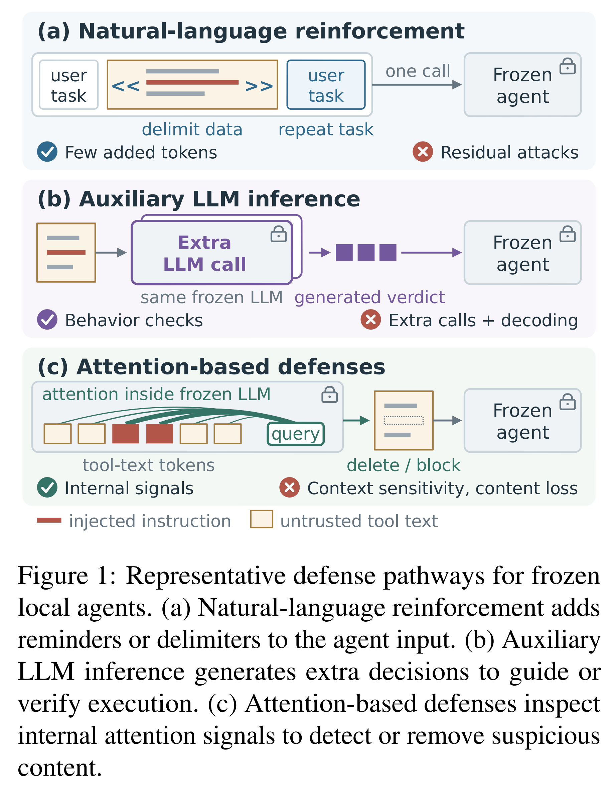

이러한 family 는 저자의 목표에 대해 서로 다른 trade-off 를 보인다.

* **Natural-language reinforcement:** Lightweight 하지만, 저자의 local-agent evaluation 에서는 상당한 attack success 가 여전히 남아 있다 (Sec. 5.2).
* **Auxiliary LLM inference:** Protection 을 강화할 수 있지만, task model 을 재사용하는 경우에도 추가 call 과 생성된 decision 은 추가 inference budget 을 소비한다 (Sec. 5.3).
* **Attention-based defenses:** Internal attention signal 을 활용하여 생성된 verification response 에 대한 의존성을 줄인다는 점에서 유망한 접근법을 제공한다.
  * Challenge 는 task evidence 를 희생하지 않으면서 이러한 signal 을 신뢰할 수 있게 만드는 것이다. Score 는 검사 대상 text 및 주변 context 에 의존할 수 있으며, removal 은 유용한 content 를 제거할 수 있다.
  * 이러한 challenge 는 Sec. 3 의 design requirement 에 대한 동기가 된다.

저자는 frozen model 이 injected instruction 과 benign task content 를 구별하는 데 도움을 주는 짧은 soft prompt (continuous input embedding 의 sequence) 를 탐색하는 SEAL 을 제안한다. SEAL 은 trusted context 로부터 구축한 scoring reference 와 유용한 content 를 보존하도록 optimize 된 selective removal 을 결합한다. Defense response 를 생성하거나 task model 의 weight 를 변경하지 않고, agent 가 실행을 계속하기 전에 tool output 을 sanitize 한다.

저자의 contribution 은 다음과 같다.

* 저자는 frozen local agent 에서 attention-based sanitization 을 분석하고, 신뢰할 수 있는 scoring 및 task preservation 에 필요한 requirement 를 식별한다.
* 저자는 task model 로부터 security signal 을 이끌어내기 위해 soft prompt 를 탐색하고, benign content 를 보존하면서 injected instruction 을 선택적으로 제거하는 SEAL 을 제안한다.
* 여러 benchmark 에 걸친 7 개의 baseline defense 와의 비교 evaluation 및 추가 robustness analysis 를 통해, 저자는 SEAL 이 낮은 defense-related token cost 로 높은 Joint 를 유지하면서 attack success 를 감소시킴을 보여준다.

# 2. Related Work

## 2.1. Indirect Prompt Injection Attacks

Indirect prompt injection 은 external content 에 삽입된 instruction 을 통해 LLM application 의 행동 방향을 변경한다.

* InjecAgent 와 AgentDojo 는 tool-using agent 에서 이러한 위협을 evaluate 하는 반면, AgentDyn 은 유용한 third-party instruction 을 포함하는 open-ended task 를 다룬다.
* Adaptive attack 은 더 약한 evaluation 또는 non-adaptive evaluation 에서 발견되지 않은 failure 를 추가적으로 드러낸다.

종합하면, 이러한 연구는 task preservation 및 defense 에 맞추어 조정된 attack 과 함께 security 를 evaluate 해야 할 필요성을 제기한다.

## 2.2. Indirect Prompt Injection Defenses

Frozen local agent 에 대해 저자는 protection 의 주된 원천에 따라 runtime defense 를 세 가지 family 로 구분한다.

#### Natural-language reinforcement

Natural-language reinforcement 는 generation input 에 trust boundary 를 전달한다.

* Sandwich 는 external content 뒤에 user request 를 반복한다.
* Spotlighting 은 해당 content 에 표시를 추가하고 이를 처리하는 방법에 대한 instruction 을 추가한다.

#### Auxiliary LLM inference

Auxiliary LLM inference 는 실행 과정에 명시적인 check 를 추가한다.

* AttriGuard 는 external observation 내의 control cue 를 약화시킨 상태에서 agent 를 다시 실행하여 제안된 tool call 을 검사한다.
* DRIFT 는 task plan 을 구축하고, plan 으로부터의 deviation 을 validate 하며, 충돌하는 instruction 을 masking 한다.
* MELON 은 task-independent action 을 탐지하기 위해 원래 user request 와 masking 된 user request 하에서의 tool call 을 비교하는 반면, TaskShield 는 instruction 과 tool call 이 user goal 을 달성하는 데 기여하는지를 확인한다.
* AgentDojo 의 `tool_filter` 는 실행 전에 LLM call 을 통해 task-relevant tool 을 선택한다.

#### Attention-based defenses

Attention-based defense 는 internal signal 로부터 detection 또는 removal decision 을 도출한다.

* Attention Tracker 는 original instruction 에서 벗어나는 attention shift 를 탐지한다.
* PISanitizer 는 scoring token 을 생성하고 해당 token 의 attention 을 사용하여 의심스러운 span 을 localize 하고 제거한다.
* RENNERVATE 는 token-level detection 및 sanitization 을 위해 head 와 response token 에 걸쳐 attention 을 pooling 한다.
* RAP-ID 는 detection 을 위해 system-anchor key comparison 을 attention 및 logit signal 과 결합한다.

# 3. Observations

Attention-based defense 는 frozen task model 의 internal signal 을 사용하여 신뢰할 수 없는 tool text 를 검사한다. 저자는 이러한 signal 과 그에 따른 sanitization 이 어디에서 실패할 수 있는지를 조사하고, 신뢰할 수 있으면서 task 를 보존하는 defense 를 위한 세 가지 challenge 를 도출한다.

* $F$ 를 frozen task model, $\mathcal{H}$ 를 새로운 tool output $U$ 이전의 conversation history, $C_0$ 를 trusted initial context 로 정의한다.
* $C_0$ 와 달리 $\mathcal{H}$ 는 이전의 신뢰할 수 없는 observation 을 포함할 수 있다.
* IPI 시도에서 attacker 는 original user request 의 범위를 벗어나도록 $F$ 의 행동 방향을 변경하기 위해 $U$ 내의 instruction 을 사용한다.
* Attacker 는 tool text 를 수정할 수 있지만, $C_0$, backbone weight 또는 defense parameter 는 수정할 수 없다.

Attention 은 하나의 model position 에 있는 query 와 input token 을 나타내는 key 를 비교한다. Softmax 는 이러한 compatibility score 를 context 전반에 대한 weight 로 normalize 한다. Attention Tracker 는 prompt 의 마지막 position 에서 이러한 weight 를 읽는 반면, PISanitizer 는 생성된 token 으로부터 이를 읽는다. 저자는 대표적인 sanitizer 로 PISanitizer 를 조사하며, 공개된 rule 을 SEAL 에 사용된 것과 동일한 frozen task backbone 에 맞게 적용한다.

#### O1: The scoring reference depends on the inspected text

PISanitizer 는 검사 대상 context $(\mathcal{H}, U)$ 로부터 token 을 생성하고 해당 token 의 attention 을 사용하여 instruction 의 위치를 찾는다. 따라서 $U$ 는 자기 자신을 판단하는 데 사용되는 query 에 영향을 미친다.

* 242 개의 Banking/Slack pair 에 대해 저자는 변경되지 않은 goal sentence 뒤에 20-token control suffix 또는 optimized suffix 를 배치한다.
* Control suffix 를 사용했을 때 탐지된 185 개의 pair 중, optimized suffix 는 65 개의 pair 를 첫 번째 round 의 goal-detection threshold 미만으로 낮춘다.
* Optimized input 의 모든 key 를 고정한 상태에서 control query vector 를 복원하면, 이 65 개의 pair 중 50 개 (76.9%) 에서 detection 이 복구된다 (Tab. 1).

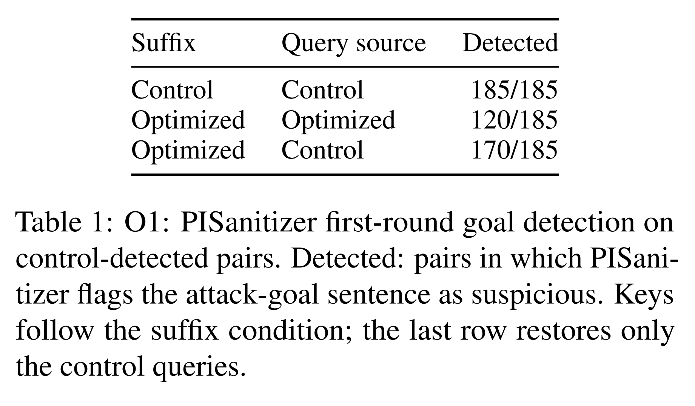

이러한 intervention 은 query 의 변화가 detection failure 에 기여하는 요인임을 보여준다. 추가 control 및 removal outcome 은 Appendix B.1 에 제시되어 있다. 이러한 result 는 **C1: payload manipulation 으로부터 scoring reference 를 보호하는 것** 에 대한 동기가 된다.

#### O2: Token scores are relative to competing context

Softmax 는 각 token 의 unnormalized weight 를 context token 전체의 weight 합으로 나눈다. Query 가 고정되고 target key 가 변경되지 않더라도, 추가적인 competing weight 는 해당 token 의 normalized score 를 낮춘다.

* 242 개의 Banking/Slack pair 에 대해 저자는 첫 번째 goal sentence 를 보존하면서 payload 를 반복한다.
* Payload 를 5 번 배치하면 PISanitizer 의 기존 150 개 removal decision 중 85 개 (56.7%) 가 뒤집힌다. 대신 4 개의 benign sentence 를 추가하면 150 개 중 26 개 (17.3%) 가 뒤집힌다 (Tab. 2).
* 생성되는 token ID 를 고정하거나 더 큰 round budget 을 사용하더라도 decision reversal 은 지속된다 (Appendix B.2).

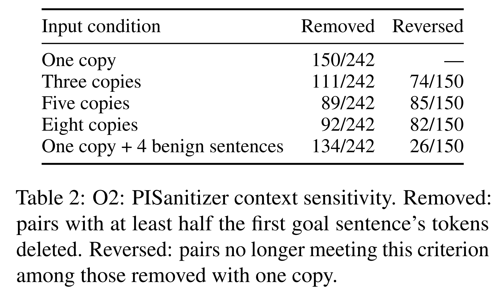

이러한 reversal 은 추가된 context 에 대한 sanitizer 의 민감도를 보여준다. Control experiment 는 query 변화, normalization 및 span selection 의 개별적인 기여를 구별하지는 못한다. Normalized score 가 competing token 에 명시적으로 의존한다는 점은 **C2: competing token 이 normalization 을 통해 score 를 변경하지 못하도록 하는 것** 에 대한 동기가 된다.

#### O3: Attack suppression can sacrifice task performance

Fig. 2 는 AgentDojo 에서 PISanitizer 와 Attention Tracker 에 의해 제거된 content 를 조사한다.

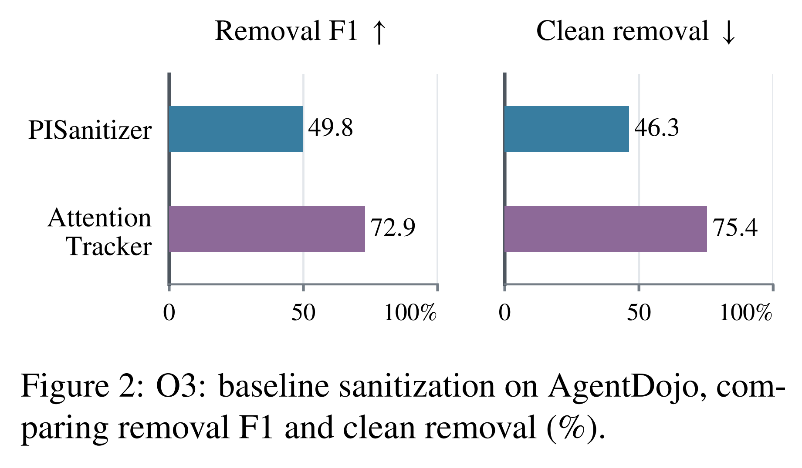

* Removal F1 은 검증된 clean episode 와 attacked episode 에 걸쳐 전체 injected block 을 삭제하는 것에 대한 character-level micro-F1 이다. Block 외부의 삭제는 false positive 로 계산된다.
* Clean removal 은 clean task 에서 제거된 original character 의 비율을 전체 character 에 걸쳐 통합하여 계산한 것이다.
* PISanitizer 는 clean text 의 46.3% 를 제거하고, Attention Tracker 는 더 높은 removal F1 에도 불구하고 75.4% 를 제거한다.
* 이러한 descriptive comparison 은 각 method 의 자체 online trajectory 를 따른다. Appendix C.2 는 metric 의 세부 사항과 SEAL 과의 비교를 제공한다.
* AgentDojo 에서 두 method 모두 no defense 대비 더 낮은 attack success 와 더 낮은 clean task success 를 보인다 (Tab. 3).

이는 **C3: 유용한 task evidence 를 보존하면서 malicious instruction 을 제거하는 것** 에 대한 동기가 되며, malicious content 의 식별과 intervention 이 제거하는 대상에 대한 control 을 모두 필요로 한다.

이러한 observation 은 세 가지 challenge 에 대한 동기가 된다. 즉, 검사 대상 text 로부터 scoring reference 를 보호하는 것 (C1), context normalization 으로 인한 score 의존성을 방지하는 것 (C2), removal 동안 유용한 evidence 를 보존하는 것 (C3) 이다. Sec. 4 에서는 SEAL 이 각 challenge 를 해결하는 방법을 설명한다.

# 4. Method

SEAL 은 C1–C3 를 각각 해결하기 위해 세 가지 component (M1–M3) 를 결합하며, frozen task model $F$ 를 사용하여 각 tool output $U$ 에 score 를 부여하고 agent 가 실행을 계속하기 전에 의심스러운 text 를 선택적으로 제거한다 (Fig. 3).

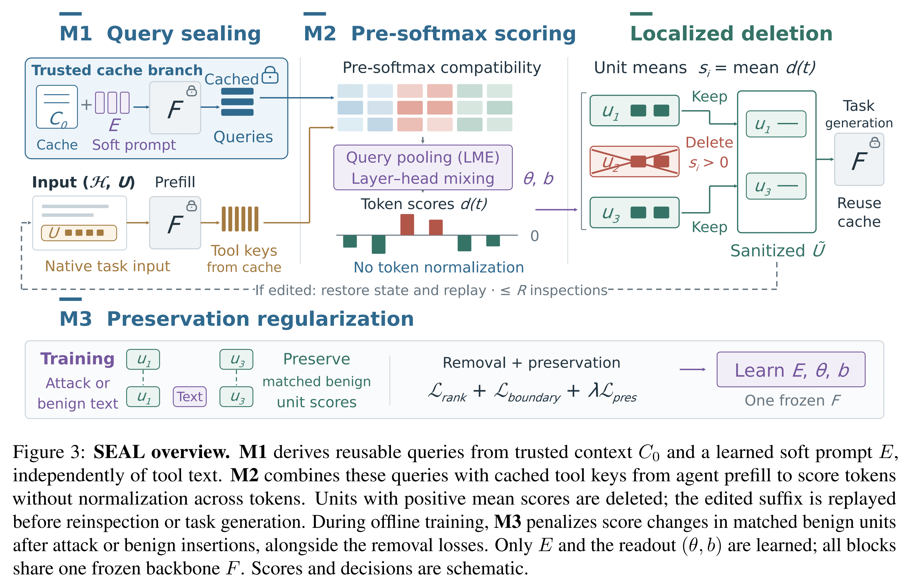

## 4.1. M1: Query Sealing

검사 대상 text 가 scoring reference 를 변경하지 못하도록 하기 위해 (C1), SEAL 은 trusted initial context $C_0$ 와 학습된 soft prompt 로부터 query 를 구성한다.

* 여기서 $C_0$ 는 tool definition 을 포함하는 agent 의 initial system message 및 user message 를 포함한다.
* Soft prompt $E=(e_1,\ldots,e_M)$ 은 학습된 $M$ 개의 continuous input embedding 으로 구성되며, $e_j$ 는 prompt position $j$ 에서의 embedding 을 나타낸다.
* $C_0$ 이후 agent 의 cached state 를 복사한 것으로부터, 저자는 별도의 branch 에서 $F$ 의 선택된 layer 중 가장 깊은 layer 까지 $E$ 만을 처리한다. 이러한 branch 는 task-generation state 를 update 하지 않는다.

$\ell$ 을 선택된 attention layer 의 index 로, $h$ 를 해당 layer 의 query head 의 index 로 정의한다. $Q^F_{\ell hj}(C_0;E)$ 는 query normalization 을 포함한 frozen model 의 prompt position $j$ 에서의 query 를 나타내며, $\Pi$ 는 positional encoding 에 의해 회전되지 않는 coordinate 를 선택한다고 정의한다.

Sealed query $q_{\ell hj}$ 는 다음과 같다.

$$
q_{\ell hj}=\Pi Q^F_{\ell hj}(C_0;E),\qquad j=1,\ldots,M.
\tag{1}
$$

$C_0$ 와 $E$ 가 고정되면, 이러한 task-conditioned query 는 tool text 및 이후의 agent message 와 독립적이며, 이를 통해 C1 을 해결한다.

* 저자는 trusted context 당 한 번 이러한 query 를 cache 하고, 여러 tool call 에 걸쳐 이를 재사용한다.
* $E$ 는 task-generation input 에 추가되지 않는다.
* Inspection 은 추가 instruction 없이 agent 의 native input 을 사용한다.

## 4.2. M2: Pre-softmax Scoring

C2 를 해결하기 위해 SEAL 은 context token 간 normalization 이전의 compatibility 를 읽는다. Agent 가 $(\mathcal{H}, U)$ 에 대해 수행하는 causal prefill 은 tool key 를 제공하며, inspection 은 task generation 에 사용되는 것과 동일한 cache 에서 이를 읽는다.

$U$ 내의 token position $t$ 에 대해 다음과 같이 정의한다.

* $g(h)$ 는 query head $h$ 를 해당 query head 와 공유되는 key head 에 mapping 한다.
* $k_{\ell g(h)t}$ 는 backbone 의 key normalization 을 포함하고 $\Pi$ 에 의해 projection 된 cached key 이다.
* $d_h$ 는 projection 이전의 전체 attention-head dimension 을 나타낸다.

Layer–head compatibility score $a_{\ell h}(t)$ 는 log-mean-exp (LME) 를 통해 $M$ 개의 sealed query 를 aggregate 한다.

$$
a_{\ell h}(t)=\log\left[\frac{1}{M}\sum_{j=1}^{M}\exp\left(\frac{q_{\ell hj}^{\top}k_{\ell g(h)t}}{\sqrt{d_h}}\right)\right],
\tag{2}
$$

* Qwen 의 경우 $d_h=256$ 이므로, $\Pi$ 가 192 개의 coordinate 를 유지하더라도 scale 은 $1/\sqrt{256}$ 이다. Gemma 는 자체 native scaling 을 사용한다 (Appendix A.5).
* 이러한 aggregation 은 다른 text 에 대한 normalization 없이 하나의 token 에 대한 query 들을 결합한다.
* Non-rotary coordinate 는 별도로 계산된 query 와 key 사이의 직접적인 rotation mismatch 를 방지한다.

$\theta$ 가 학습된 mixing logit $\theta_{\ell h}$ 의 집합을 나타내고, $w_{\ell h}$ 가 선택된 모든 layer–head pair 에 걸쳐 normalize 된 weight 를 나타낸다고 정의한다.

학습된 scalar bias $b$ 와 함께 token score $d(t)$ 는 다음과 같다.

$$
\begin{aligned}
w_{\ell h}&=\frac{\exp(\theta_{\ell h})}{\sum_{\ell',h'}\exp(\theta_{\ell'h'})},\\
d(t)&=\sum_{\ell,h}w_{\ell h}a_{\ell h}(t)+b.
\end{aligned}
\tag{3}
$$

이러한 softmax 는 input token 이 아니라 학습된 layer–head weight 를 normalize 한다. Weight 와 bias 는 inference 시 고정된다.

저자는 추가적인 trusted-context standardization 없이 raw compatibility 를 사용한다.

Query 와 key 가 고정되면 token 의 score 는 competing context token 과 독립적이며, 이를 통해 C2 를 해결한다. Key 자체는 여전히 contextual 하며, 앞선 text 가 변경되면 변경될 수 있다.

## 4.3. M3: Preservation Regularization

C3 를 해결하기 위해 M3 는 insertion 이후에도 변경되지 않은 benign unit 에 대해 안정적인 score 를 유도하는 preservation regularizer 를 추가한다. 이는 아래에서 설명하는 removal objective 및 localized deletion 을 보완한다.

#### Units and decisions

저자는 sentence boundary 와 structural boundary 를 사용하여 $U$ 를 연속적인 unit 으로 분할한다.

* $u_i$ 는 $i$ 번째 unit 을 나타낸다.
* $T_i$ 는 해당 unit 의 character span 과 겹치는 token position 의 set 이다.
* $s_i$ 는 해당 unit 의 mean token score 이다.

Whitespace 가 아닌 text 와 적어도 하나의 overlapping token 을 포함하는 unit 에 대한 decision 은 다음과 같다.

$$
s_i=\frac{1}{|T_i|}\sum_{t\in T_i}d(t),\qquad \text{delete }u_i\text{ if }s_i>0.
\tag{4}
$$

학습된 bias $b$ 는 decision boundary 를 제어한다. Whitespace 로만 구성된 unit 과 overlapping token 이 없는 unit 은 삭제하지 않는다.

$R$ 을 첫 번째 pass 를 포함하는 전체 inspection-pass budget 으로 정의한다.

* Deletion 이후 저자는 유지된 unit 을 순서대로 concatenate 하고, 편집된 output 을 다시 segmentation 하며, pass 가 남아 있는 동안 이를 재검사한다.
* 삭제된 unit 이 없거나, whitespace 가 아닌 text 가 남아 있지 않거나, $R$ 번의 pass 가 완료된 경우 중단한다.

Deletion 은 또한 attention key 와 value 및 backbone 의 recurrent state 와 convolution state 를 포함하는 pre-tool cache 를 복원한다.

저자는 추가 inspection 또는 task generation 이전에 편집된 suffix 를 replay 한다. $\widetilde{U}$ 를 최종 sanitized output 이라고 정의한다.

* Agent 는 채택된 cache 를 사용하여 $(\mathcal{H},\widetilde{U})$ 로 실행을 재개한다.
* 마지막 inspection 에서 text 가 삭제되더라도, 편집된 suffix 는 generation 이전에 처리된다. 이러한 replay 는 추가적인 inspection pass 가 아니다.

#### Optimizing the prompt and readout

Training example 은 attack-goal unit 과 benign unit 을 구별한다.

$\mathcal{P}$ 와 $\mathcal{N}$ 을 minibatch 에서 각각의 unit score 를 모은 집합으로 정의하고, $p\in\mathcal{P}$ 와 $n\in\mathcal{N}$ 은 개별 score 를 나타낸다고 정의한다. Softplus function $\phi(x)$ 를 다음과 같이 정의한다.

$$
\phi(x)=\log(1+e^x).
$$

저자는 ranking loss $\mathcal{L}_{\mathrm{rank}}$ 와 boundary loss $\mathcal{L}_{\mathrm{boundary}}$ 를 사용한다.

$$
\mathcal{L}_{\mathrm{rank}}=\mathbb{E}_{p,n}\phi(1-p+n),
\tag{5}
$$

$$
\mathcal{L}_{\mathrm{boundary}}=\mathbb{E}_{p}\phi(1-p)+\mathbb{E}_{n}\phi(1+n).
\tag{6}
$$

여기서 expectation 은 empirical average 이다.

* Ranking term 은 minibatch 내의 모든 positive–negative score pair 에 대해 평균을 계산하고, 각 boundary term 은 이에 대응하는 score 에 대해 평균을 계산한다.
* 첫 번째 loss 는 goal unit 이 benign unit 보다 높은 순위를 갖도록 한다.
* 두 번째 loss 는 1 의 margin 을 두고 두 unit 이 deletion boundary 의 서로 반대편에 위치하도록 한다.
* Benign training data 는 인간 독자를 대상으로 하는 정당한 instruction 을 포함하므로, 명령형 표현 자체만으로는 positive label 이 되지 않는다.

Preservation regularization (M3) 을 위해 $r$ 을 benign base output, $r^+$ 를 attack payload 또는 인간을 대상으로 하는 benign instruction 이 삽입된 대응 output 으로 정의한다.

* $\mathcal{B}_{\mathrm{pair}}$ 는 minibatch 내 이러한 pair 의 base output 을 indexing 한다.
* $\mathcal{A}_r$ 은 $r$ 과 $r^+$ 사이에서 변경되지 않은 benign unit 을 matching 하는 index pair $(i,j)$ 를 포함한다.
* Score $s_i^r$ 및 $s_j^{r^+}$ 는 각각의 context 에 존재하는 대응 unit 에 동일한 unit scorer 를 적용한 것이다.
* 저자는 $\mathcal{A}_r$ 이 비어 있지 않은 pair 를 유지한다.
* $H$ 를 transition 값이 1 인 Huber loss 로 정의하고, $\lambda\geq0$ 을 전체 objective $\mathcal{L}$ 에서 preservation loss $\mathcal{L}_{\mathrm{pres}}$ 에 부여되는 weight 로 정의한다.

$$
\begin{aligned}
\mathcal{L}_{\mathrm{pres}}&=\sum_{r\in\mathcal{B}_{\mathrm{pair}}}\frac{1}{|\mathcal{A}_r|}\sum_{(i,j)\in\mathcal{A}_r}H\left(s_i^r-s_j^{r^+}\right),\\
\mathcal{L}&=\mathcal{L}_{\mathrm{rank}}+\mathcal{L}_{\mathrm{boundary}}+\lambda\mathcal{L}_{\mathrm{pres}}.
\end{aligned}
\tag{7}
$$

Preservation loss 는 각 pair 내부의 matched unit 에 대해 평균을 계산하고, 이를 pair 에 걸쳐 합산한다.

* Insertion 이 key 를 변경할 때 변경되지 않은 benign unit 에서 발생하는 score 변화에 penalty 를 부여하며, localized deletion 과 함께 evidence preservation 을 유도한다.
* 이러한 regularizer 는 C3 를 해결하기 위해 M2 의 fixed-query/key property 를 보완한다. 모든 input 에서 score 가 변경되지 않거나 unit 이 보존됨을 보장하지는 않는다.

저자는 $F$ 를 frozen 상태로 유지하면서 $E$, $\theta$ 및 $b$ 에 대해 offline 으로 $\mathcal{L}$ 을 jointly minimize 한다.

이러한 parameter 는 inference 시에도 고정된다. SEAL 은 defense decoding 또는 별도의 verifier model 을 필요로 하지 않는다.

Implementation 및 cost 의 세부 사항은 Appendix A.4 및 C.1 에 제시되어 있다.

# 5. Evaluation

## 5.1. Experimental Setup

#### Datasets and Metrics

저자는 frozen Qwen3.5-9B 를 AgentDojo (57 개의 clean episode / 778 개의 attacked episode) 및 AgentDyn (각 setting 당 60 개 / 560 개의 episode) 에서 evaluate 하며, frozen Gemma 4 12B 에서 재현 실험을 수행한다.

* Main comparison 은 공통 episode set 에서 고정된 benchmark attack 을 사용한다.
* AgentDyn A 는 original parser 를 사용하며, AgentDyn B 는 schema-aware argument coercion 을 적용한다.

저자는 다음과 같은 evaluation metric 을 사용한다.

* **Clean Utility (CU):** Clean task 의 success 를 측정한다.
* **Attack Success Rate (ASR):** Attacker 의 success 를 측정한다.
* **Attacked Utility (AU):** Attack 상황에서의 task success 를 측정한다.
* **Joint:** 동일한 attacked episode 에서 attack 은 실패하고 task 는 성공하는 경우를 측정한다.

Agent error 가 발생한 completed episode 도 evaluation 에 포함된다.

Threshold sweep 과 ablation 은 task-complete subset 을 사용한다. 이는 각 task 의 clean episode 와 고정된 seed 로 균등하게 sampling 한 하나의 attacked episode 로 구성된다. Sampling 된 key 는 method, variant 및 threshold 에 걸쳐 공유된다.

#### Baselines

저자는 Sec. 2.2 의 세 가지 family 를 포괄하기 위해 대표적인 최근 defense 를 선택한다.

Qwen 에서의 comparison 은 no defense 와 7 개의 defense 를 포함한다.

* **Natural-language reinforcement:** Sandwich 및 Spotlighting
* **Auxiliary LLM inference:** AttriGuard, DRIFT 및 `tool_filter`
* **Attention-based defenses:** Attention Tracker 및 PISanitizer

공개된 implementation 은 auxiliary call 을 포함하여 동일한 frozen task model 을 사용한다.

#### Experimental Details

SEAL 은 leave-one-domain-out AgentDojo training 과 validation-based checkpoint selection 을 사용하며, evaluation family 에 해당하는 attacked output 을 training 과 validation 모두에서 제외한다.

AgentDyn 은 추가 training 없이 AgentDojo 의 all-domain checkpoint 를 재사용한다.

저자는 다음과 같이 설정한다.

* Soft-prompt length: $M=16$
* Inspection budget: $R=2$
* Preservation weight: $\lambda=0.2$

## 5.2. Security and Task Performance

AgentDojo 에서의 result 는 Tab. 3 에 제시되어 있다.

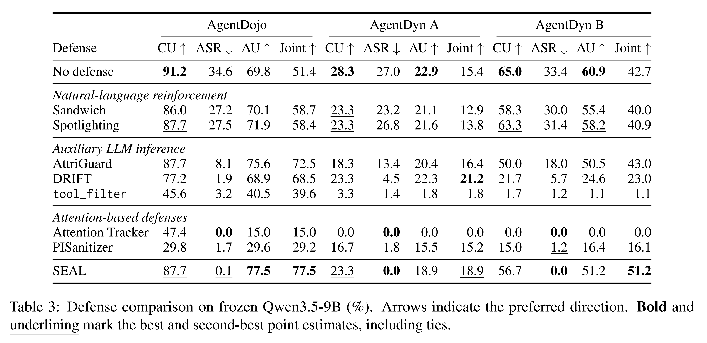

* **Natural-language reinforcement:** Trust boundary 를 강제하기 위해 reminder 또는 delimiter 에 의존한다.
  * SEAL 의 direct sanitization 은 더 우수한 task completion 과 함께 더욱 강력한 protection 을 제공한다. ASR 은 27.2–27.5% 에서 0.1% 로 감소하고, Joint 는 18.8–19.1 percentage point 증가한다.
* **Auxiliary LLM inference:** 추가 call 을 통해 protection 을 향상시키지만, 그렇지 않았다면 task execution 에 사용할 수 있었던 budget 을 소비한다. Task model 을 재사용하더라도 이러한 overhead 가 제거되지는 않는다.
  * SEAL 은 생성된 defense decision 없이 해당 family 의 최고 Joint 를 능가한다 (77.5% vs. 72.5%).
  * Sec. 5.3 은 resource-constrained local deployment 에서 이러한 설계로 얻어지는 token-cost advantage 를 정량화한다.
* **Attention-based defenses:** 기존 attention-based defense 는 최대 1.7% 의 ASR 을 달성하지만, Joint 는 15.0–29.2% 에 불과하다.
  * 낮은 ASR 만으로는 유용한 protection 이 보장되지 않는다.
  * SEAL 의 더 높은 Joint 는 정당한 task 에 필요한 evidence 를 유지하면서 injected instruction 을 억제하는 selective removal 에 초점을 맞춘 설계를 뒷받침한다.

SEAL 은 두 가지 AgentDyn setting 모두에서도 0.0% 의 ASR 을 달성한다.

* AgentDyn B 에서 Joint 는 가장 높다 (51.2%).
* 그러나 AgentDyn A 에서는 DRIFT 보다 낮다 (18.9% vs. 21.2%).

## 5.3. Inference Cost

Tab. 4 는 tool context 당 defense-related Prefill 및 Generation token cost 를 비교한다.

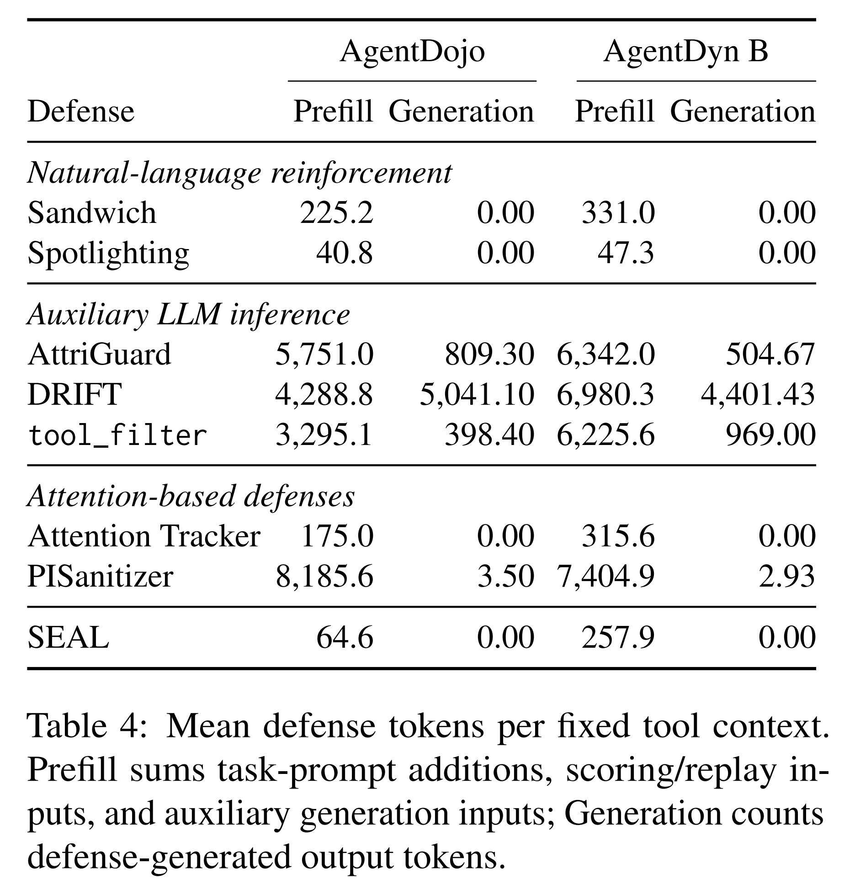

* SEAL 은 AgentDojo 와 AgentDyn B 에서 각각 평균 64.6 개 및 257.9 개의 Prefill token 을 사용하며, 이는 PISanitizer 대비 각각 약 127 배 및 29 배의 감소에 해당한다.
* Auxiliary generation 없이 SEAL 은 lightweight natural-language reinforcement method 와 비슷한 token cost 를 발생시키면서도 상당히 높은 Joint 와 낮은 ASR 을 달성한다 (Tab. 3).

저자는 고정된 tool context 에서 Prefill input token 과 Generation output token 을 계산함으로써 이러한 cost 를 산출한다 (Appendix C.1).

## 5.4. Ablation Study

Tab. 5 는 query sealing (M1), pre-softmax scoring (M2) 및 preservation regularization (M3) 을 각각 제거하고 재학습한 variant 를 비교한다.

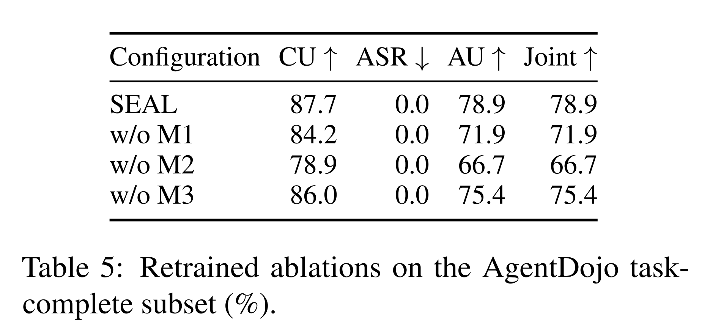

* Query sealing (M1) 이 없는 경우, Joint 는 SEAL 의 78.9% 에서 71.9% 로 감소한다.
* Pre-softmax scoring (M2) 을 제거하는 경우 가장 큰 감소가 발생하여, Joint 는 66.7% 로 감소한다.
* Preservation regularization (M3) 이 없는 경우에도 Joint 는 75.4% 로 감소한다.

이러한 result 는 attack 상황에서의 성공적인 task completion 에 대한 각 component 의 기여를 뒷받침한다.

Experimental detail 및 M1–M3 에 대한 추가 analysis 는 Appendix B.3 및 A.4 에 제시되어 있다.

## 5.5. Adaptive Attack Evaluation

Tab. 6 은 변경되지 않은 attack instruction 앞에 추가되는 20-token prefix 를 optimize 하는 grey-box attack 을 evaluate 한다.

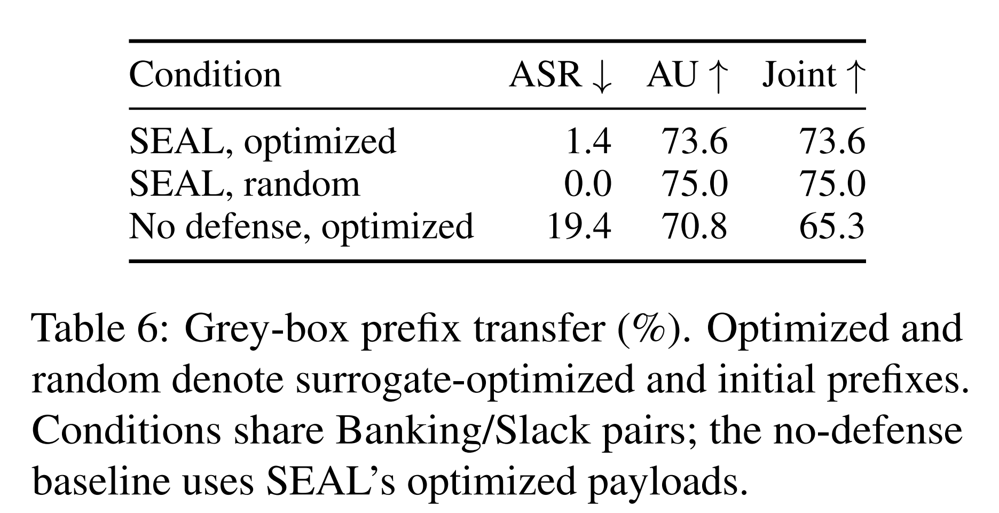

* Attacker 는 deployment 된 defense parameter 에 접근하지 않고 backbone 과 공개된 training recipe 로 구축한 surrogate 를 사용한다. Random control 은 optimize 하지 않은 initial prefix 를 사용한다.
* 동일한 optimized payload 에 대한 no defense 와 비교하여, SEAL 은 ASR 을 19.4% 에서 1.4% 로 감소시키고 Joint 를 65.3% 에서 73.6% 로 향상시킨다.
* SEAL 은 surrogate-optimized attack 에 대해서도 효과적이며, 이는 query sealing 이 injected text 로부터 scoring reference 를 보호한다는 점과 일치한다.

Deployment 된 defense parameter 에 접근할 수 있는 더욱 강력한 white-box attack 은 Appendix C.3 에서 evaluate 한다.

## 5.6. Security–Utility Tradeoff

Fig. 4 는 deletion threshold 에 대한 SEAL 의 민감도를 evaluate 한다.

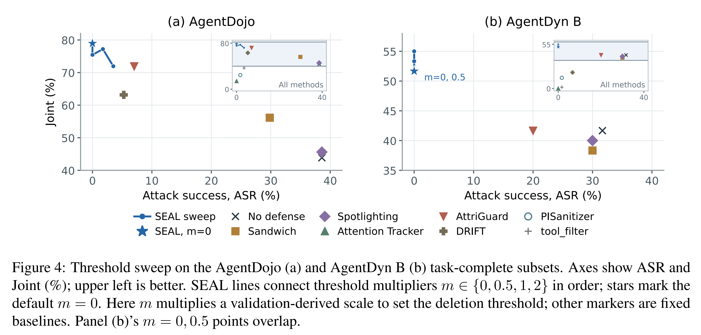

* 평가된 threshold 에 걸쳐 SEAL 은 AgentDojo (0.0–3.5%) 및 AgentDyn B (0.0%) 에서 낮은 ASR 을 유지한다.
* Joint 는 각각 71.9–78.9% 및 51.7–55.0% 의 범위를 갖는다.

이러한 result 는 SEAL 이 단일 operating point 에 의존하는 것이 아니라, 다양한 threshold 에 걸쳐 낮은 attack success 와 높은 safe task completion 을 유지함을 나타낸다.

상세한 result 는 Appendix C.4 에 제시되어 있다.

## 5.7. Replication on Gemma 4 12B

Tab. 7 은 동일한 recipe 로 SEAL 을 재학습한 이후 frozen Gemma 4 12B 에서의 result 를 보고한다.

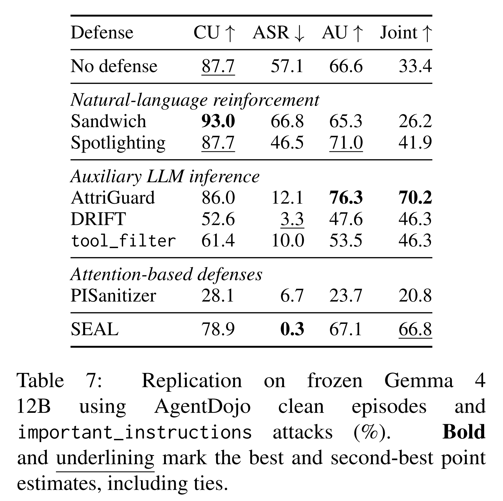

* No defense 와 비교하여 SEAL 은 ASR 을 57.1% 에서 0.3% 로 감소시키고 Joint 를 33.4% 에서 66.8% 로 향상시킨다.
* 평가된 method 중 가장 낮은 ASR 과 두 번째로 높은 Joint 를 달성한다.

이러한 result 는 SEAL 의 설계가 단일 model 에 특화된 것이 아니라 서로 다른 backbone 에 걸쳐 적용 가능함을 시사한다.

Implementation 및 training detail 은 Appendix A.5 에 제시되어 있다.

# 6. Conclusion

저자는 frozen local task model 을 사용하여 신뢰할 수 없는 tool output 을 선택적으로 sanitize 하기 위해 soft prompt 와 scoring readout 을 학습하는 SEAL 을 제안한다.

* Query sealing 은 scoring reference 를 검사 대상 text 와 독립적으로 유지한다.
* Pre-softmax scoring 은 context token 간 normalization 을 방지한다.
* Preservation regularization 은 sanitization 동안 유용한 task evidence 의 보존을 유도한다.

이러한 component 는 함께 auxiliary LLM inference 없이 selective removal 을 가능하게 한다.

여러 evaluation 에 걸쳐 저자는 SEAL 이 낮은 추가 token cost 를 발생시키면서 attack 을 억제하고 attack 상황에서의 task completion 을 향상시킴을 보여준다. 또한, 동일한 recipe 로 두 번째 backbone 에서 재학습하는 경우에도 safe task completion 이 향상되며, 이는 서로 다른 model family 에 대한 SEAL 의 적용 가능성을 뒷받침한다.